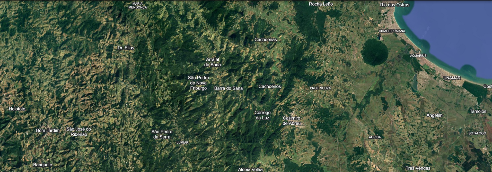
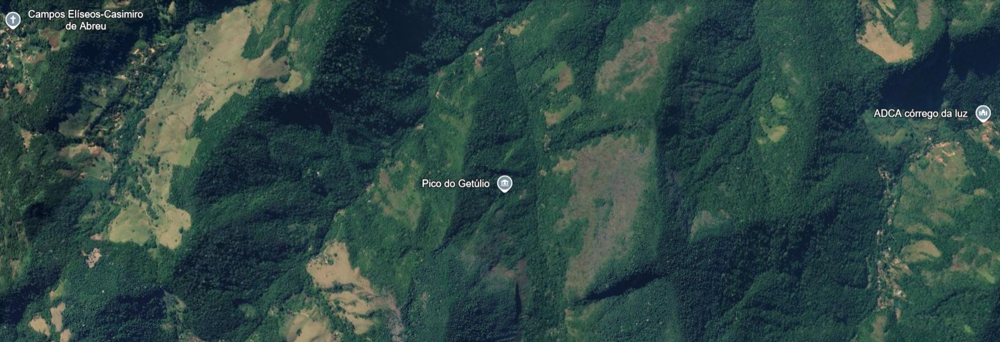
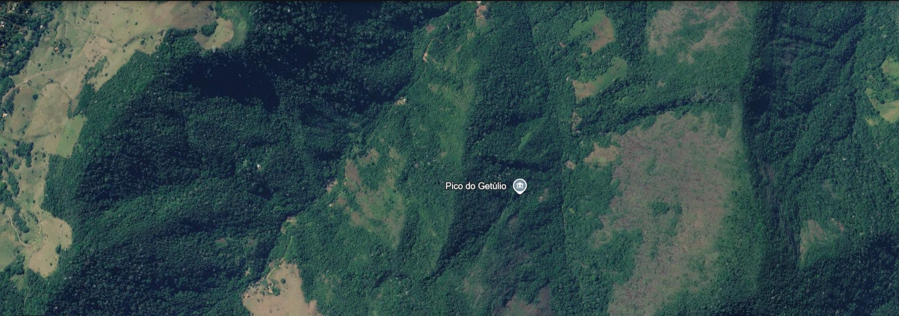
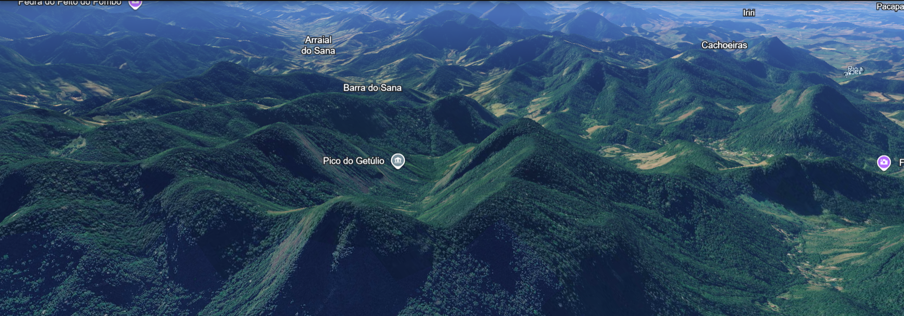

# Análise Forense e Computação Gráfica
## Tema: Cadeias Montanhosas e Relevo Acentuado

**Estudante:** Emily Reis de Camargo  
**Turma:** 3º D - DS  
**Disciplinas:** Ciências de Dados e Computação Gráfica

---

## 1. Sobre o projeto

Este trabalho tem como objetivo estudar como sistemas de visualização, como o Google Earth, representam terrenos com grandes variações de altitude.

O tema escolhido foi cadeias montanhosas e relevo acentuado, com observação da região do Morro do Getúlio, no Paraná.

O estudo aborda como a altitude da câmera influencia o nível de detalhes das imagens e como as sombras e a modelagem 3D ajudam na representação das montanhas.

## 2. Desenvolvimento em Python

No arquivo `script.py`, foi criada a função `carregar_camada_satelite(lista_altitudes)`.

A função recebe uma lista com pelo menos cinco valores de altitude, em metros, e utiliza estruturas condicionais (`if`, `elif` e `else`) para selecionar o nível de resolução.

A classificação funciona da seguinte maneira:

| Altitude da câmera | Resolução | Representação |
|---|---|---|
| Acima de 10.000 m | Baixa | Visão geral das cadeias montanhosas |
| Entre 1.000 m e 10.000 m | Média | Picos, vales e encostas |
| Abaixo de 1.000 m | Alta | Rochas, pequenas encostas e sombras |

### Valores utilizados no teste

Foram utilizados cinco valores para testar o funcionamento do programa:

- 25.000 metros: baixa resolução.
- 15.000 metros: baixa resolução.
- 8.000 metros: média resolução.
- 3.500 metros: média resolução.
- 500 metros: alta resolução.

O código utiliza uma estrutura de repetição `for` para percorrer cada altitude e verificar em qual condição ela se encaixa.

A ideia é que, quando a câmera está distante do terreno, não seja necessário apresentar todos os detalhes. Conforme ela se aproxima, o nível de detalhamento pode aumentar.

**Observação:** o código desenvolvido é uma simulação da escolha do nível de resolução. Ele não baixa imagens de satélite nem realiza renderização 3D real.

## 3. Processamento e tratamento de imagens

Na representação de cadeias montanhosas, um dos desafios é unir diferentes imagens de satélite para formar uma representação contínua do terreno.

Esse processo é conhecido como *stitching* (costura de imagens).

Durante a união das imagens, podem aparecer diferenças de cores, iluminação, contraste e textura. Isso pode acontecer porque as imagens foram capturadas em momentos ou condições diferentes.

Para melhorar a continuidade visual, é necessário ajustar cores, brilho e contraste, além de alinhar corretamente as imagens para evitar divisões visíveis.

No relevo montanhoso, as sombras também representam um desafio. Dependendo da posição da iluminação, algumas partes das encostas ficam mais escuras, podendo esconder detalhes do terreno.

Por outro lado, essas sombras ajudam a perceber as diferenças de altura e a profundidade das montanhas.

## 4. Sombras e modelagem 3D

A modelagem 3D permite representar o terreno considerando três dimensões: largura, comprimento e altura.

Para isso, podem ser utilizados dados de elevação, que indicam as diferentes alturas de cada região. Esses valores ajudam a formar uma representação com picos, encostas e vales.

As imagens de satélite podem ser aplicadas sobre essa superfície como texturas, deixando a representação mais próxima da aparência real do terreno.

A iluminação também é importante. Quando a luz incide sobre as montanhas, algumas regiões ficam iluminadas enquanto outras permanecem na sombra.

Isso ajuda o usuário a identificar as inclinações e compreender melhor o formato do relevo.

No caso das cadeias montanhosas, as sombras podem destacar a profundidade dos vales e as diferenças de altura entre os picos.

## 5. Leis da Gestalt na interface do Google Earth

A Gestalt estuda como o cérebro humano organiza e interpreta os elementos visuais.

Duas leis que podem ser observadas na interface do Google Earth são:

### 5.1 Figura-Fundo

Essa lei acontece quando conseguimos diferenciar o elemento principal dos elementos que estão ao seu redor.

No Google Earth, o terreno ocupa a maior parte da tela e representa o foco da visualização. Os menus, ferramentas e painéis ficam separados visualmente, permitindo que o usuário concentre sua atenção no mapa.

### 5.2 Proximidade

A lei da proximidade explica que elementos próximos uns dos outros tendem a ser percebidos como parte de um mesmo grupo.

Na interface do Google Earth, as ferramentas de navegação aparecem agrupadas na barra superior. Além disso, as informações sobre um local ficam reunidas em um painel.

Essa organização facilita a identificação das ferramentas e torna a navegação mais intuitiva.

### 5.3 Como o design ajuda o usuário?

A barra de pesquisa permite encontrar rapidamente uma região específica. Os controles de zoom ajudam a aproximar ou afastar a visualização, enquanto a organização das ferramentas facilita o acesso às funções disponíveis.

Dessa forma, o design contribui para que o usuário consiga explorar o relevo sem precisar procurar cada ferramenta separadamente.

## 6. Imagens e evidências

Foram realizadas capturas de tela no Google Earth para observar a região montanhosa escolhida e registrar diferentes perspectivas do terreno.

As imagens estão organizadas na pasta `imagens` do repositório.

### Capturas do Google Earth

## 7. Conclusão

Com este trabalho, foi possível compreender como a altitude influencia a seleção do nível de detalhes em sistemas de visualização geográfica.

Também foi possível estudar os desafios de unir imagens de satélite, ajustar suas características visuais e representar terrenos montanhosos utilizando iluminação, sombras e modelagem 3D.

A atividade permitiu relacionar os conceitos de Ciências de Dados e Computação Gráfica com a representação de terrenos reais, utilizando o Morro do Getúlio como referência de observação.

## 8. Referências

- Google Earth: https://earth.google.com/web/
- Instituto Água e Terra (IAT): Plano de Uso Público Emergencial do Parque Estadual Pico Paraná, 2025. https://www.iat.pr.gov.br/
